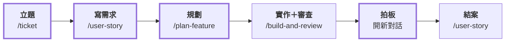

# sdd-harness

> **English summary** — A Claude Code plugin that makes AI-written features safe to merge. You describe what you want and
> make the decisions; the agent researches your codebase, writes the tests first, implements, reviews its own work with a
> separate set of agents, and hands you one list of the judgment calls it made along the way. The docs below are in Traditional Chinese.

**讓 Claude Code 寫的功能可以放心合併：你只負責做決定，讀現有的 code、寫測試、實作、審查，agent 自己跑完。**

裝好之後，用起來大概是這樣（示意）：

```text
你：    /ticket 預約要能取消，已經開始的不能取消
agent： 管理員可以取消別人的預約嗎？請給我一個實際會發生的例子。
你：    可以。例：小美是管理員，幫請假的阿明取消週三 10:00 的 A 會議室。
agent： 這是一個中型任務，我開好一張單了。接下來我會讀現有的 code、用白話寫出做完後系統會怎樣，請你確認。
        ……（你確認需求、選做法之後）……
agent： 實作和審查都跑完了，測試全過。中途有 3 個決定是我自己選的，整理成清單了，請你逐題確認。
```

| 你做的事 | agent 做的事 |
|---|---|
| 講一句需求、給一到三個例子 | 讀現有的 code，弄清楚系統現在怎麼運作 |
| 確認白話寫的需求是不是你要的 | 提兩種做法讓你比，列出每個要測的情況 |
| 從兩種做法選一個、定幾個細節 | 一次一條測試：先寫測試、再寫 code 到通過 |
| 最後逐題確認 agent 自己做的決定 | 換另一批 agent 審查，並故意把 code 改壞，確認測試真的抓得到 |

它真的抓得到東西。一個實際案例：某個功能的測試全部通過、需求和測試的對應表也全部打勾，
審查的 agent 逐條讀測試內容才發現，其中一則需求對應的四組測試根本沒有檢查那件事。[更多案例](docs/CASES.md)

## 流程

一個功能從頭到尾走六個階段。粗框是需要你出手的階段，其他階段 agent 自己跑。



| 階段 | 在做什麼 | 為什麼要有這一步 | 你要做的 |
|---|---|---|---|
| **立題** | agent 把你的一句需求變成一張單：要什麼、任務多大、哪些不做 | 一開始沒講清楚範圍，後面每一步都會往錯的方向做 | 給一個初步需求和一到三個具體例子，確認 agent 提議的任務大小 |
| **寫需求** | agent 先讀現有的 code，再用白話寫出「做完之後系統會怎樣」 | 白話寫的，你一眼就看得出「這不是我要的」；等看到 code 才發現就太晚 | 先看一則範例確認寫法，再確認整份需求 |
| **規劃** | agent 先提兩種做法讓你比，再把細節一個一個拿出來定，最後列出每個要測的情況 | 改方向在這裡最便宜；只看一種做法沒辦法判斷它好不好 | 從兩種做法選一個，每個細節從選項裡選一個 |
| **實作＋審查** | agent 一次寫一條測試，先讓它失敗再寫到通過；寫完換另一批 agent 審查，還會故意把 code 改壞，確認測試真的抓得到 | 寫的 agent 不審自己寫的；「測試有過」不等於「測試有用」 | 不用顧，等 agent 跑完 |
| **拍板** | agent 把中途自己做的決定整理成一份清單，一題一題問你 | agent 不停下來問才能一口氣做完，但決定權還是你的 | 每題回「維持」或「改掉」 |
| **結案** | agent 照實際做出來的結果更新需求文件，把清單上這一項標成完成 | 文件記的是做出來的東西，不是當初的計畫 | 自己 push、開 PR |

「拍板」＝你確認或推翻 agent 自己做的決定。實作和審查期間 agent 只有碰到救不回來的事才會停下來問你：
刪資料、push、動到別人做到一半的東西。

任務有大有小，不是每件事都要走完六個階段：

| 任務大小 | 例子 | 怎麼走 |
|---|---|---|
| tiny | 一個錯字、一個小 bug | 立題後直接修，補一條測試 |
| small | 幾個相關的小調整 | 六個階段都走，規劃比較精簡 |
| medium | 一個全新的功能 | 六個階段完整走 |
| large | 一整組功能 | 立題時拆成一張總單加幾張小單，每張小單各自走 |

## 安裝

**先確認合不合用**：指令的內容是照 **FastAPI + SQLModel + pytest** 的後端專案寫的（例如檢查 API 文件、資料庫常見的坑）。
其他技術棧裝得起來，但審查的檢查清單要自己改。另外需要 Claude Code、Python 3.10+、git。

在 Claude Code 裡打這兩行：

```text
/plugin marketplace add wrbyepct/sdd-harness
/plugin install sdd-harness@sdd-harness
```

指令的完整名稱是 `/sdd-harness:<名稱>`，沒有跟別的指令撞名時可以直接打 `/<名稱>`。

> 老實說：最新這一版（從「立題」開始的流程）還沒有用真實的工作從頭跑過一輪。其他的限制見 [docs/ROADMAP.md](docs/ROADMAP.md)。

## 第一次用

### 先試一下（不用做任何設定）

前兩個階段只會讀你的 code、寫文件，不跑測試也不改 code，所以裝完就能試。挑一個你真的想做的小功能：

| 你打什麼 | 你會看到什麼 |
|---|---|
| `/ticket <一句需求>` | agent 一次問你一個問題（一定會跟你要例子），然後提議任務大小。你確認後得到一張單 `features/1-<名稱>/ticket.md`，以及一份工作清單 `features/BACKLOG.md` |
| `/user-story #1` | agent 讀現有的 code，寫成 `research.md`（系統現在怎麼運作）；再給你一則白話需求當範例，你確認寫法後它寫完整份 `user_story.md` |

`#1` 是那張單的編號，之後每個指令都用編號接續。讀完 `user_story.md`，你就知道這套流程對你的專案有沒有用。

### 要讓 agent 開始寫 code 之前

agent 需要知道怎麼跑你的測試。把下面這段貼進專案的 `CLAUDE.md`，改成你的值：

```markdown
## Harness config

| key | 值 |
|---|---|
| `base_branch` | `main` |
| `test_cmd` | `pytest` |
| `lint_cmd` | `ruff check .` |
```

再把測試和 lint 指令加進 `.claude/settings.json` 的權限白名單（例如 `"Bash(pytest:*)"`），
不然 agent 自己跑到一半會停下來等你按允許。

其餘的設定（隔離的測試資料庫、API 文件格式……）都有預設值或可以留空，
用到再看 [docs/CONFIG.md](docs/CONFIG.md)。

### 兩份要你自己寫的文件（第一次可以先不寫）

後面的示範會提到這兩份文件。它們**不是指令產生的**，是你照範本自己寫、放進專案的；沒有也能跑，agent 會跳過那一步。

| 文件 | 寫什麼 | 沒有的話 | 怎麼產生 |
|---|---|---|---|
| `docs/CONVENTIONS.md`（寫法慣例） | 你的專案「同一件事統一怎麼寫」，每條規則指向一支真的存在的程式當樣本 | agent 改成每次翻附近的程式照著抄 | 複製 plugin 的 [docs/CONVENTIONS.md](docs/CONVENTIONS.md) 範本到你的專案，照範本開頭的步驟填（先請 agent 盤點現有寫法，你每項選一種） |
| `docs/PRODUCT_PRINCIPLES.md`（產品原則） | 產品不能違反的幾條原則 | agent 寫完需求後不做這項對照 | 複製 plugin 的 [docs/PRODUCT_PRINCIPLES.md](docs/PRODUCT_PRINCIPLES.md) 範本來改 |

寫好後把路徑填進設定表的 `conventions_doc`／`product_principles_doc`。建議先不寫、走完一兩個功能，發現 agent 的寫法常常不一致時再補。

然後接著走：

| 你打什麼 | 你會看到什麼 |
|---|---|
| `/clear`，然後 `/plan-feature #1` | 兩種做法的比較表，你選一個；接著一次一個細節讓你選。中途 agent 會請你打 `/clear`，之後再打一次 `/plan-feature #1` 接續（`/clear` 會清掉沒選上的做法，免得混進後面） |
| `/build-and-review #1` | 不用顧。跑完你會有一串 commit、一份審查報告、一份「待確認清單」，以及一段要貼到新對話的開工指令 |
| 把那段開工指令貼到新對話 | agent 照清單一題一題問你，你回「維持」或「改掉」 |
| `/user-story #1` | agent 照實際做出來的結果更新需求文件，把這張單標成完成。push 和開 PR 由你來 |

## 走完一個完整功能

上面是最短路徑；這一段把每個階段實際會看到的東西攤開。以虛構的會議室預約系統為例，做「取消預約」這個功能。
這裡會開始用到一些專有的詞，看不懂可以查最下面的[詞彙表](#詞彙表)。

### 0. 立題（`/ticket`）

```text
/ticket 預約要能取消：一般成員只能取消自己的，管理員可以取消任何人的，已經開始的不能取消
```

agent 只看入口層（路由清單、相關模組有哪些檔），一次問你一題，一定會問到一到三個具體例子；然後提議級別（這裡是 medium）。
你拍板後它建 `features/5-cancel-booking/ticket.md`，並在 `features/BACKLOG.md` 未結案表加一列。
ticket 只寫**現況／預期／例子／接在哪／不做／完成條件／待拍**，不寫解法；最後一行是開工指令 `/user-story #5`。

### 1. 先研究現況，再寫白話的 user story（`/user-story`）

```text
/user-story #5
```

agent 讀 ticket、把這一項改成「進行中」，派 `codebase-researcher` 讀現在的 code（預約流程、權限怎麼判斷、哪些測試鎖著什麼），
寫成 `research.md`：每一條「系統現在怎麼做」都有編號（例 `B3`），之後所有文件引用編號，不憑印象。
然後它先給**一則範例** user story 讓你確認格式和用詞：

> **3. 管理員取消別人已經開始的預約，會被擋下**
> - **角色**　會議室管理員（小美）
> - **情境**　週一 10:05，A 棟 301 的 10:00 預約已經開始（現況 B3：開始時間一到，預約就鎖定）
> - **動作**　小美按下取消
> - **預期行為**　系統擋下，顯示「預約已開始，無法取消」；**預約人自己按也一樣**
> - **為什麼這樣設計**　會議已經在進行，取消會讓使用紀錄和實際狀況對不上

範例 OK 才寫完整份，寫完逐則對照 `docs/PRODUCT_PRINCIPLES.md`（你自己寫的產品原則，沒寫就跳過），違反的列出來讓你決定改 story 還是記例外。
**user story 是需求的最高原則**（僅次於產品原則）：它是給不寫程式的人看的，所以你自己也能一眼看出「這不是我要的」。
拍板後它停下來，印出下一步：`/clear` 然後 `/plan-feature #5`。

### 2. 兩個架構方案擇一，再逐決策拍板（`/plan-feature`）

```text
/plan-feature #5
```

它只接 `#N`（或資料夾路徑）。過程中會請你 `/clear` 兩次，每次 `/clear` 之後都再打一次 `/plan-feature #5`，它自己看資料夾停在哪一站、從那裡接續。第一次進場：
`lessons-recaller` 撈這個模組過去踩過的雷，然後**一定出兩個正交的架構方案**寫成 `proposal.md`，
用對照表比（列＝這次特有的 driver → 產品原則 → 可維護性 → 效率；格子只填勝／平／負＋一句證據），給你推薦：

> | driver | A：取消＝狀態改 `cancelled` | B：取消＝刪列＋寫稽核表 |
> |---|---|---|
> | 取消後要能查「誰取消的」（這次特有） | 勝：同一列多兩欄 | 負：要 join 稽核表 |
> | 產品原則 7「過去的不改，只能加註」 | 勝 | 負：刪列等於改歷史 |
>
> 推薦 A，第一條分出勝負的 driver 是「誰取消的」。

你選一案，它記成 `D0`，印出下一步：`/clear` 然後 `/plan-feature #5`。重入後從 S1 開始，一次只丟一個拍板題：

> **D2：「已經開始」用什麼判斷？**
> | | 做法 | 代價 |
> |---|---|---|
> | A | 預約開始時間 ≤ 現在 | 簡單；時區要統一用 UTC |
> | B | 有人已經報到 | 要多查報到紀錄，還沒報到的過期預約會變成「可取消」 |
>
> 建議 A，因為……

你回「A」，它記成 `D2` 附上 why，再問下一題。決策走完寫 `plan.md`，再印一次下一步：`/clear` 然後 `/plan-feature #5`。
重入後寫 `detailed-plan.md`（寫完自掃「加適當驗證」「TBD」這種寫了等於沒寫的句子）與 `test.md`。
test.md 的每一條 TC 都標出它鎖哪一則：

```text
| TC-07 | [US 3] 管理員取消已開始的預約 → 409「預約已開始，無法取消」 |
| TC-08 | [US 3] 開始前一分鐘取消 → 放行（接受面） |
```

然後派 `spec-gap-hunter` 找 spec 沒提但最可能咬人的輸入（例如「取消後能不能再預約同一時段？」），一題一題給你拍、回寫 test.md；
最後 `story_lock_check.py` 對帳，確認沒有一則 user story 是沒有測試鎖住的。

### 3. 實作＋審查，一條做到底、中間不停（`/build-and-review`）

```text
/build-and-review #5
```

接下來不用顧：

1. **build**：有寫 `docs/CONVENTIONS.md`（你自己照範本寫的寫法慣例，見上面「兩份要你自己寫的文件」）就先讀裡面指的樣本程式照形狀寫；
   沒寫、或慣例沒涵蓋到，才派 `neighbor-finder` 去翻附近的程式。
   每個 Inc（＝一顆 commit）由 `scripts/inc_brief.py` 抽一份 brief，派一個 `implementer` 嚴格 TDD，一次一條 TC、先紅後綠；
   主 agent 只寫 brief 的「前面留下的」那段、派 `test-runner` 用隔離 DB 跑全套、派 `mutation-prover` 打 implementer 列的靶，全綠才 commit。
   遇到有取捨的新決策點**不停**：當下寫進 `decisions-pending.md` 一題（選了什麼、為什麼、另一個選項、翻案要動哪裡），選最好的做下去。
2. **review**：派一個全新 context 的子 agent 跑 `/auto-code-review`，它再派六個專責 agent 平行審查；
   Critical／High 由 `finding-verifier` 試著推翻，每個修正由 `mutation-prover` 實際改壞原始碼證明測試咬得住。
   review 的拍板題追加進同一份 `decisions-pending.md`。
3. **交接**：收尾自動跑 `/decision-handoff`，補齊 `decisions-pending.md` 的現況與 context，印一段「拍板 session 開工指令」給你。

### 4. 拍板 session：一題一題做決定

把那段開工指令貼到新 session。agent 先核對分支停在 build 完那一刻（hash、顆數、工作區乾淨），
然後照總表一次一題用 user story 格式講給你聽，你回「維持」或「翻案＋一句理由」，它當下填進檔裡。
全部拍完它列翻案清單，你說動工才照「翻案要動哪裡」施工：fixup 到對應的 commit、autosquash、跑全套。

### 5. 結案複查，然後 push 由你來

```text
/user-story #5
```

同一句，資料夾裡已經有 `plan.md` 所以進複查模式：拿規劃前那份 user story 當底稿，對照 plan、test.md、每一輪 review、commit 訊息，逐則定稿、標上「已實作逐則複查」（結案複查）。
標完順手收尾：依賴這張的下游 ticket 回填「接在哪」、ticket 與 BACKLOG 改「完成」並移到已結案表。
**push 和開 PR 由你自己來**，`guard-rails` 會擋下 agent 直接 commit／push 保護分支。

## 想知道更多

| 文件 | 什麼時候看 |
|---|---|
| [docs/REFERENCE.md](docs/REFERENCE.md) | 想查某一支指令或某一個 agent 做什麼、產出什麼 |
| [docs/CONFIG.md](docs/CONFIG.md) | 要填設定、要按版本或產品線分資料夾、要並行開第二棵工作樹 |
| [docs/DESIGN.md](docs/DESIGN.md) | 想知道為什麼這樣設計（文件誰說了算、為什麼找問題的 agent 不改 code） |
| [docs/CASES.md](docs/CASES.md) | 想看審查實際抓到過什麼 |
| [docs/ROADMAP.md](docs/ROADMAP.md) | 想知道哪些還沒驗證、接下來要做什麼 |
| [CHANGELOG.md](CHANGELOG.md) | 每一版改了什麼 |

## 詞彙表

文件和指令裡會出現的詞，第一次看到可以回來查：

| 詞 | 意思 |
|---|---|
| ticket | 立題產生的那張單：要什麼、從哪接、不做什麼、怎樣算做完。不寫怎麼做 |
| BACKLOG | 工作清單，一張表列出所有單和它們的狀態 |
| user story | 白話需求。一則一則寫「誰、在什麼情況、做了什麼、系統會怎樣、為什麼這樣設計」，給不寫程式的人也看得懂 |
| research | agent 讀完現有 code 寫的現況紀錄，每一條有編號，後面的文件都引用編號 |
| proposal | 兩種做法的比較 |
| plan、決策（`D1`、`D2`…） | 規劃文件；規劃時定下的每個細節各有編號，code 和測試可以指回來 |
| test.md、TC | 測試清單；TC 是其中一條測試 |
| `[US 3]` | 測試上的標記，表示這條測試在保護第 3 則需求 |
| Inc | 一小段可以單獨提交的進度，一段對應一個 commit |
| mutation | 故意把 code 改壞，看測試會不會失敗。不會失敗就代表那條測試沒有用 |
| decisions-pending | 待確認清單：agent 中途自己做的決定，等你拍板 |
| 拍板 | 你確認或推翻 agent 做的決定 |
| 結案複查 | 做完之後，照實際結果把 user story 更新一遍 |
| lessons | 教訓：這次踩到的坑記下來，下次開工前 agent 會先讀 |
| 母題、子題 | large 任務的總單與拆出來的小單 |

## 授權

MIT
