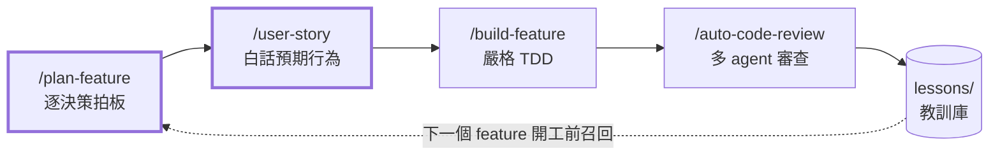

# sdd-harness

> **English summary** — A Claude Code plugin that turns feature work into a spec-driven pipeline:
> a decision-by-decision **plan** → a plain-language **user story** → **strict TDD** one test at a time →
> an unattended **multi-agent code review** where high-severity findings are adversarially verified and
> every fix is proven by **actually running mutations**. Humans only review decisions; everything between
> the gates runs on its own. Lessons from each review are written back and recalled before the next feature.
> Extracted from the harness I use daily on a production FastAPI + SQLModel + PostgreSQL backend
> (~150 API endpoints, 7,000+ tests, 177 review reports in ~7 months).

這是我每天開發後端時用的 Claude Code 工作流程，整理成 plugin 公開。它解決的問題是：
**讓 AI 寫的 code 可以被信任，而人只需要在「做決定」的地方出現。**

## 流程



`/build-and-review` 把 build 和 review 串成一條，中間不停。

**四個人工關卡**（其他全部無人值守）：

| 關卡 | 人做什麼 |
|---|---|
| plan 決策點 | 每個決策看 A/B/C 比較表後選一個，決策編號 `D<n>`、附 why |
| user story 拍板 | 先看一則範例、確認格式與用詞，再看整份 |
| 實作中的新決策點 | build 發現 spec 沒寫到、而且有取捨的地方（串接模式會先選推薦值、最後一起報） |
| review 拍板題 | review 修不了、需要改「預期行為」的才問人 |

## 設計理念

### 1. 文件是決策紀錄，測試是行為的保證
plan 記「為什麼」（D 編號），user story 記「做出來會怎樣」（給不寫程式的人看），test.md 把每一則 user story
變成可執行的鎖。三者用 `[US n]` 標記串起來，`scripts/story_lock_check.py` 機械對帳，`story-lock-auditor`
再逐則確認 assert 真的咬住預期行為。

### 2. 子 agent 的價值是隔離，不是分工
pytest 幾百行輸出、幾千行的 diff、翻遍兩百則記憶找教訓——這些都交給子 agent，主 context 只收一張表。
每個 agent 的 `tools:` 只給它需要的（純讀的不給寫入工具），審查與修 code 分開：
**找問題的 agent 不改 code，改 code 的主 agent 不審自己。**

### 3. 不相信推論，只相信實跑
- `finding-verifier`：對每條 Critical／High finding 做對抗式驗證，**給不出具體重現輸入就降級**。
  錯的 finding 代價很高：改 code、補測試、再被 mutation 打，整串白做。
- `mutation-prover`：每一條修正與鎖，都實際把原始碼改壞、跑測試、確認變紅、再還原。
  早期用「讀 code 推論哪些測試會紅」，結果漏掉分支，而且錯的方向永遠是高估自己的測試。

### 4. 教訓要能被召回，不然只是日記
review 收尾把「值得記住的事」寫成 `lessons/<area>/` 一則一檔（格式見 `docs/LESSONS.md`），
`lessons-recaller` 在 plan、build、review 開工前依模組與關鍵字撈出最相關的十條，
落到該用的地方（某個決策的比較表、某條要補的 TC）。

### 實際抓到過的問題（都在無人值守的 review 中被找到，並由 mutation 證明修正有效）
- `str(uuid4)` 少了括號 → 所有 session 共用同一個 token ID，任何一人登出，全部人的 refresh token 一起失效
- logout 只把 access token 列入黑名單 → refresh token 在有效期內仍可換發
- CSV 批次匯入時每一列都重算一次 argon2 → 1,000 列就 timeout
- 狀態轉換與結算分成兩次 commit → 中途失敗會卡在無法復原的狀態

## 裡面有什麼

| 類別 | 內容 |
|---|---|
| commands（8） | `plan-feature`、`user-story`、`build-feature`、`build-and-review`、`auto-code-review`、`code-review`、`dry-audit`、`design-audit` |
| agents（10） | review：`reviewer`、`story-lock-auditor`、`finding-verifier`、`dry-auditor`、`design-auditor`、`mutation-prover`；build：`spec-gap-hunter`、`neighbor-finder`、`test-runner`；共用：`lessons-recaller` |
| hooks | `guard-rails`：擋直接 commit／push 保護分支、`git restore` 整檔退回、測試互撞等（規則見 `hooks/guard_rails.py` 開頭） |
| scripts | `story_lock_check.py`（user story ↔ 測試對帳）、`lessons_index.py`（教訓索引）、`scan_sensitive.sh`（公開前掃敏感字） |

## 安裝

```text
/plugin marketplace add wrbyepct/sdd-harness
/plugin install sdd-harness@sdd-harness
```

然後照 [`docs/CONFIG.md`](docs/CONFIG.md)：

1. 把 `## Harness config` 表貼進專案的 `CLAUDE.md`，填上你的測試指令、隔離 DB 環境變數、base branch 等。
2. 把測試與 lint 指令加進 `.claude/settings.json` 的權限白名單，否則無人值守的串接會卡在權限提示。

**前置需求**：Claude Code、Python 3.10+、git。command 內容以 **FastAPI + SQLModel + pytest** 為前提
（例如 Swagger 對齊、ORM 踩雷），換其他技術棧需要改寫 `code-review` 的檢查清單。

## 怎麼用：走一個 feature

以虛構的會議室預約系統為例，做「取消預約」這個 feature。下面是我實際的工作方式；
plugin 指令的完整名稱是 `/sdd-harness:<name>`，沒有撞名時可以直接打 `/<name>`。

### 1. 提需求，逐決策拍板（`/plan-feature`）

```text
/plan-feature 預約要能取消：一般成員只能取消自己的，管理員可以取消任何人的，已經開始的不能取消
```

agent 先在背景派 `lessons-recaller` 撈這個模組過去踩過的雷，同時讀相關的 code
（現有的預約流程、權限怎麼判斷、隔壁端點怎麼寫），然後一次只丟一個拍板題給你：

> **D2：「已經開始」用什麼判斷？**
> | | 做法 | 代價 |
> |---|---|---|
> | A | 預約開始時間 ≤ 現在 | 簡單；時區要統一用 UTC |
> | B | 有人已經報到 | 要多查報到紀錄，還沒報到的過期預約會變成「可取消」 |
>
> 建議 A，因為……

你回「A」，它記成 `D2` 附上 why，再問下一題。你只需要做決定，不用寫文件。

### 2. 先寫 user story，拍板（`/user-story`）

決策走完，`/plan-feature` 會接著跑 `/user-story`。它先給**一則範例**讓你確認格式和用詞：

> **3. 管理員取消別人已經開始的預約，會被擋下**
> - **角色**　會議室管理員（小美）
> - **情境**　週一 10:05，A 棟 301 的 10:00 預約已經開始
> - **動作**　小美按下取消
> - **預期行為**　系統擋下，顯示「預約已開始，無法取消」；**預約人自己按也一樣**
> - **為什麼這樣設計**　會議已經在進行，取消會讓使用紀錄和實際狀況對不上（D2）

範例 OK 才寫完整份。**user story 是需求的最高原則**：它是給不寫程式的人看的，所以你自己也能一眼看出「這不是我要的」。

### 3. 以 user story 為準，寫三份文件

拍板後才寫 `plan.md` → `detailed-plan.md` → `test.md`。test.md 的每一條 TC 都標出它鎖哪一則：

```text
| TC-07 | [US 3] 管理員取消已開始的預約 → 409「預約已開始，無法取消」 |
| TC-08 | [US 3] 開始前一分鐘取消 → 放行（接受面） |
```

`story_lock_check.py` 對帳，確認沒有一則 user story 是沒有測試鎖住的。

### 4. 實作＋審查，一條做到底（`/build-and-review`）

```text
/build-and-review cancel-booking
```

接下來不用顧：

1. **build**：`spec-gap-hunter` 先找文件漏掉的邊界（例如「取消後能不能再預約同一時段？」），`neighbor-finder` 找出要照抄的既有寫法，
   然後嚴格 TDD，一次一條 TC、先紅後綠，測試交給 `test-runner` 用隔離 DB 跑。遇到有取捨的新決策點，先選推薦值、記成「暫定拍板」。
2. **review**：派一個全新 context 的子 agent 跑 `/auto-code-review`，它再派六個專責 agent 平行審查；
   Critical／High 由 `finding-verifier` 試著推翻，每個修正由 `mutation-prover` 實際改壞原始碼證明測試咬得住。
3. **回報**：一份合併報告，只列需要你決定的事（暫定拍板＋review 拍板題，都用 user story 的格式寫）。

想自己盯實作的話，改成分開跑：`/build-feature cancel-booking`（遇到新決策點會停下來問你），
做完再 `/auto-code-review`。

### 5. 你做最後的決定

讀合併報告、回答拍板題；翻案的行為回寫進 user story 和測試。**push 和開 PR 由你自己來**，
`guard-rails` 會擋下 agent 直接 commit／push 保護分支。

## 目前的限制

- plugin 裡的子 agent 不吃 frontmatter 的 `hooks:`，所以「每個 agent 只准跑哪些 Bash 指令」還沒做；
  目前靠 `tools:` 白名單加上 agent 本文的規則。下一步是在 `hooks/hooks.json` 依 `agent_type` 分流。
- `mutation-prover` 直接在工作區改壞再還原（有精準字串替換與還原後重跑的保護），還沒改成 worktree 隔離。
- 例子用的是虛構的會議室預約系統；command 的規則本身來自真實專案的踩雷紀錄。

## 未來優化

這套 harness 不是定稿：每一輪真實的 build／review transcript 都會被拿來檢討，踩到的坑會回寫成規則；
我也正在自學 Stanford CS146S（The Modern Software Developer），把課程內容對照到這套流程上持續改進。
下面是目前排定的優化項目，做完會更新到這裡。

| # | 項目 | 要解決的問題 | 狀態 |
|---|---|---|---|
| 1 | **Research 階段 skill 化**（`/research`） | 規劃前讀 codebase 的研究目前只留在對話裡。改成 skill，規定「只記錄現況、不提方案」，輸出可被 plan 引用的研究文件 | 規劃中 |
| 2 | **plan 先出兩個正交的架構方案** | 現在的比較是「單一架構內逐決策」；在拆 stage 之前先比較兩個根本不同的做法，選定後清掉 context 再往下走 | 規劃中 |
| 3 | **需求 ↔ 測試追溯強制化** | `[US n]` 標記與對帳腳本已上線；下一步是舊 feature 回填，並用 hook 在 commit 時擋下沒標記的 TC | 進行中 |
| 4 | **用 hooks 把流程紀律變成機制** | 「先改 spec 再改 code」這類規則目前寫在 prompt 裡，是請求不是保證；逐條評估能否改成 hook 擋下 | 規劃中 |
| 5 | **品質判斷交給專責的 review agent** | 6 個 review agent 已上線；持續用真實 transcript 校準每個 agent 的判準與回報格式 | 進行中 |
| 6 | **context 瘦身** | 主 agent 與每個子 agent 都要載入專案規則；不需要的子 agent 用 `omitClaudeMd` 跳過，記憶索引改成按需讀取 | 規劃中 |
| 7 | **背景化與 worktree 隔離** | build → review 已能背景串接；下一步用 worktree 隔離取代「同一工作區並行」的各種防護 | 進行中 |
| 8 | **教訓庫回填** | 把歷史 code review 的 Critical／High 蒸餾成可召回的教訓檔 | ✅ 完成 |
| 9 | **子 agent 硬限制** | 依工作分級：純讀的只給讀取工具；寫報告的只准寫報告目錄；跑測試的 Bash 只准測試指令且必帶隔離 DB；會改 code 的放進 worktree。全部寫成 frontmatter／hook，不靠 prompt | 進行中 |
| 10 | **agent 查書** | 測試經典（Khorikov《Unit Testing》、Freeman & Pryce《GOOS》）已轉成可檢索的切片；讓 reviewer 在判斷 mock 用法、over-specification 時引用章節 | 規劃中 |
| 11 | **舊文件不再誤導 agent** | feature 文件按時間分資料夾，同一個行為的最新版散在多份文件裡。做法：舊文件加「歷史文件」橫幅、code 裡用 `決策 <feature> D<n>` 標籤指回決策、research 依「API 文件 → 測試 → code → 決策」順序讀、腳本檢查標籤沒有斷指標 | 設計定案 |

## 授權

MIT
