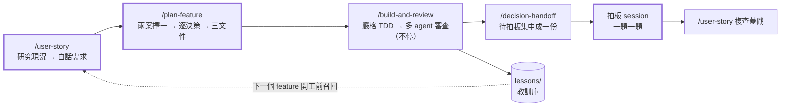

# sdd-harness

> **English summary** — A Claude Code plugin that turns feature work into a spec-driven pipeline:
> a read-only **codebase research** snapshot → a plain-language **user story** checked against product principles →
> **two orthogonal architecture proposals** (pick one, clear context) → a decision-by-decision **plan** →
> **strict TDD** one test at a time → an unattended **multi-agent code review** where high-severity findings are
> adversarially verified and every fix is proven by **actually running mutations**. Build and review never stop to ask:
> every judgment call is logged to `decisions-pending.md` and batched into one sign-off session. Humans only make
> decisions; everything between the gates runs on its own. Lessons are written back and recalled before the next feature.
> Extracted from the harness I use daily on a production FastAPI + SQLModel + PostgreSQL backend
> (~150 API endpoints, 7,000+ tests, 177 review reports in ~7 months).

這是我每天開發後端時用的 Claude Code 工作流程，整理成 plugin 公開。它解決的問題是：
**讓 AI 寫的 code 可以被信任，而人只需要在「做決定」的地方出現。**

## 流程



**權威順序：產品原則 > user story > plan 三文件。** user story 是規劃的**輸入**，不是輸出；
實作與審查全程不停，碰到的決策先選最好的做下去、記成一題，集中到下一個 session 拍板。

**四個人工關卡**（其他全部無人值守）：

| 關卡 | 人做什麼 |
|---|---|
| user story 拍板 | 先看一則範例、確認格式與用詞，再看整份；每則對照產品原則 |
| 架構 A/B 裁決 | `/plan-feature` 先出兩個正交的架構方案（`proposal.md`），你看對照表選一個，選完清 context |
| plan 決策點 | 每個決策看 A/B/C 比較表後選一個，決策編號 `D<n>`、附 why |
| 拍板 session | build 與 review 期間 agent 自己選的決策都寫在 `decisions-pending.md`；你開新 session 一題一題拍，翻案當場 fixup |

agent **仍然會停下來問**的只剩不可逆的事：刪欄位／刪資料的 migration、push、動到別人的在製品。

## 設計理念

### 1. 文件是決策紀錄，測試是行為的保證
plan 記「為什麼」（D 編號），user story 記「做出來會怎樣」（給不寫程式的人看），test.md 把每一則 user story
變成可執行的鎖。三者用 `[US n]` 標記串起來，`scripts/story_lock_check.py` 機械對帳，`story-lock-auditor`
再逐則確認 assert 真的咬住預期行為。

### 2. 子 agent 的價值是隔離，不是分工
pytest 幾百行輸出、幾千行的 diff、翻遍兩百則記憶找教訓——這些都交給子 agent，主 context 只收一張表。
每個 agent 的 `tools:` 只給它需要的（純讀的不給寫入工具），審查與修 code 分開：
**找問題的 agent 不改 code，改 code 的主 agent 不審自己。**

### 3. 不相信推論，只相信實跑
- `finding-verifier`：對每條 Critical／High finding 做對抗式驗證，**給不出具體重現輸入就降級**。
  錯的 finding 代價很高：改 code、補測試、再被 mutation 打，整串白做。
- `mutation-prover`：每一條修正與鎖，都實際把原始碼改壞、跑測試、確認變紅、再還原。
  早期用「讀 code 推論哪些測試會紅」，結果漏掉分支，而且錯的方向永遠是高估自己的測試。

### 4. 教訓要能被召回，不然只是日記
review 收尾把「值得記住的事」寫成 `lessons/<area>/` 一則一檔（格式見 `docs/LESSONS.md`），
`lessons-recaller` 在 plan、build、review 開工前依模組與關鍵字撈出最相關的十條，
落到該用的地方（某個決策的比較表、某條要補的 TC）。

### 5. 文件有權威順序，衝突時不用猜

```text
產品原則  >  user story  >  plan.md / detailed-plan.md / test.md  >  code
```

| 層 | 回答什麼 | 誰讀、什麼時候 |
|---|---|---|
| `docs/PRODUCT_PRINCIPLES.md` | 這個產品**怎麼做決定**（編號＝優先序，每條附裁決過的例子與何時反過來） | `/user-story` 逐則對照；`/plan-feature` 兩案對照表的常駐第一 driver |
| `user_story.md` | 做出來**會怎樣**，給不寫程式的人看 | 規劃的輸入；`story-lock-auditor` 拿它當靶；實作後複查定稿 |
| plan 三文件 | **為什麼這樣做**（D 編號）、落在哪支函式、哪條測試鎖住 | `/build-feature` 照它寫；`reviewer` 對它審 |
| `research.md` | 開工時系統**現在**怎麼做（一次性快照，有編號） | 上面三層引用它的編號，不憑印象描述現況 |

上層與下層衝突時，下層錯：plan 跟 story 不一致就改 plan；story 違反原則就改 story，或明寫一條例外。
agent 在實作中發現 spec 漏寫而自己做了決定，不能改上層文件，只能寫進 `decisions-pending.md` 等人拍板。
這條鏈讓「這個行為到底該是什麼」永遠有一個地方可以查，而不是翻對話紀錄。

## 裡面有什麼

| 類別 | 內容 |
|---|---|
| commands（9） | `user-story`、`plan-feature`、`build-feature`、`build-and-review`、`auto-code-review`、`decision-handoff`、`code-review`、`dry-audit`、`design-audit` |
| agents（11） | review：`reviewer`、`story-lock-auditor`、`finding-verifier`、`dry-auditor`、`design-auditor`、`mutation-prover`；plan：`codebase-researcher`；build：`spec-gap-hunter`、`neighbor-finder`、`test-runner`；共用：`lessons-recaller` |
| hooks | `guard-rails`：擋直接 commit／push 保護分支、`git restore` 整檔退回、測試互撞等（規則見 `hooks/guard_rails.py` 開頭）；`agent_bash_guard`：依子 agent 類型限制 Bash 與寫檔（純讀的不能寫、跑測試的只能跑測試指令且必帶隔離 DB） |
| scripts | `story_lock_check.py`（user story ↔ 測試對帳）、`lessons_index.py`（教訓索引）、`add_history_banner.py`（舊 feature 文件加「歷史文件」橫幅）、`scan_sensitive.sh`（公開前掃敏感字） |
| docs 範本 | `CONFIG.md`（設定表）、`LESSONS.md`（教訓格式）、`PRODUCT_PRINCIPLES.md`（產品原則）、`CONVENTIONS.md`（寫法慣例＋黃金樣本） |

### commands（你打的指令）

| command | 什麼時候打 | 做什麼 | 產出 | 會停下來問你的地方 |
|---|---|---|---|---|
| `/user-story <需求一句>` | 新 feature 的第一步 | 建 feature 資料夾、派 `codebase-researcher` 寫現況快照、以快照為據寫白話 user story、逐則對照產品原則 | `research.md`、`user_story.md` | 一則範例的格式用詞；整份拍板；違反原則的則 |
| `/user-story <feature 路徑>` | 實作與拍板都結束後 | 複查模式：拿規劃前那份當底稿，對照 plan、test.md、每輪 review、commit 訊息逐則定稿、蓋戳 | 定稿的 `user_story.md` | 每則定稿 |
| `/plan-feature <feature 路徑>` | user story 拍板後；每次 `/clear` 用同一句重入 | 第一次：兩個正交架構方案；第二次：S1–S6 逐決策、寫 plan.md；第三次：detailed-plan、test.md、派 `spec-gap-hunter`、`story_lock_check` 對帳 | `proposal.md`、`plan.md`、`detailed-plan.md`、`test.md` | 架構 A/B 裁決；每個 D 決策；spec gap 要不要補 |
| `/build-feature <feature 路徑>` | 想自己盯實作時 | 嚴格 TDD，一次一條 TC 先紅後綠，每個 Inc 一顆 commit；新決策點不停、寫進 `decisions-pending.md` | commits、`decisions-pending.md` | 只在不可逆的事（刪資料 migration、push、碰別人在製品） |
| `/build-and-review <feature 路徑>` | 平常用這個 | 串接模式跑 `/build-feature` → 自動生 review 開工指令 → 全新 context 子 agent 跑 `/auto-code-review` → 合併報告 → 自動跑 `/decision-handoff` | 上面全部＋拍板 session 開工指令 | 同上 |
| `/auto-code-review` | 想單獨審一段 commit 範圍時 | 無人值守審查：派六個 review agent、修 finding 並 fixup 到引入它的那顆 commit、mutation 證明、寫教訓 | `code_reviews/<name>.md`、`decisions-pending.md` 追加、`lessons/` | 不停（`--ask` 才問） |
| `/decision-handoff <feature 路徑>` | 收工時（`/build-and-review` 會自動跑） | 實查現況、蒐集所有待拍板題、補齊 context，印下一個 session 的逐題拍板開工指令 | `decisions-pending.md`、開工指令 | 不停 |
| `/code-review` | 手動審目前的 diff | 單次審查，含範圍外改動與 research 契約對帳；也是 `reviewer` agent 用的標準 | findings 報告 | 拍板題 |
| `/dry-audit`、`/design-audit` | 懷疑重複規則或設計繞路時 | 分別掃「同一條業務規則寫了兩份」與「行為對但寫法繞」，列清單讓你逐條拍 | 排好序的清單 | 每條拍了才動工 |

### agents（command 派出去的子 agent）

| agent | 誰派、什麼時候 | 做什麼 | 回什麼 | 工具 |
|---|---|---|---|---|
| `codebase-researcher` | `/user-story` 需求模式 | 照固定順序讀（API 文件 → 測試名稱 → code＋決策標籤 → 沿標籤進 feature 文件），只記現況、不提方案 | `research.md`：有編號的契約表、隱含規則、舊文件不一致處、沒有測試鎖的行為 | 只讀 |
| `lessons-recaller` | `/plan-feature`、`/build-feature`、`/auto-code-review` 開工前 | 依模組與關鍵字翻 `lessons/`，再翻專案記憶的硬規則；太薄才翻舊 review | 最多十條「這次會踩到的教訓」＋怎麼套用 | 只讀 |
| `spec-gap-hunter` | `/plan-feature` S8、`/build-feature` Step 1 | 對七項死角清單找「有承諾、沒有鎖」的地方（邊界、並行、順序、跨表） | gap 清單＋建議 TC | 只讀 |
| `neighbor-finder` | `/build-feature` Step 3，慣例文件沒涵蓋時才派 | 找最相似的既有實作，回「照哪個檔哪個函式」；順便建議慣例該補哪條 | 樣本指標＋三行要點 | 只讀 |
| `test-runner` | `/build-feature`、`/auto-code-review` 要跑測試時 | 用指定的那一行指令（隔離 DB）跑，幾百行輸出留在自己這邊 | passed／failed 計數、每條紅的 nodeid＋第一行錯誤、是否基線就紅 | Bash 只准測試指令 |
| `reviewer` | `/auto-code-review` 每顆 commit | 以 `/code-review` 標準審，**要實跑探針重現**，違反慣例算 Low | `code_reviews/<name>.md`＋ findings 總表 | 讀＋寫報告目錄 |
| `story-lock-auditor` | `/auto-code-review`，與 reviewer 平行 | 三方對帳：user story 每一則 ↔ test.md 的 `[US n]` ↔ 測試裡實際的 assert；標 ⚠️ 暫定改寫的則以暫定為準 | 每則「鎖住／部分／沒鎖＋缺什麼」 | 只讀 |
| `finding-verifier` | `/auto-code-review`，每條 Critical／High | 對抗式驗證：「在現在的 code 這真的會發生嗎？給我重現輸入」，答不出就降級 | 維持／降級＋重現輸入 | 只讀 |
| `dry-auditor` | `/auto-code-review` §4b | 掃這顆 commit 動到的業務規則，往整個 codebase 追第二份出處 | 零疑慮可施工清單＋待拍板清單 | 只讀 |
| `design-auditor` | `/auto-code-review` §4b，dry-auditor 之後 | 看動到的函式形狀對不對得上業務規則，跟慣例文件的黃金樣本比 | 可施工清單＋待拍板清單 | 只讀 |
| `mutation-prover` | `/auto-code-review` §5，每條修正與鎖 | 實際改壞原始碼、跑相關 TC、立刻還原；改完要 grep 確認突變真的在檔裡 | 每發「被抓到／存活」 | 唯一會暫時改 src 的 agent，主 agent 前後拍快照兜底 |

分工原則：**找問題的 agent 不改 code，改 code 的主 agent 不審自己**；每個 agent 的 Bash 與寫檔範圍由 `hooks/agent_bash_guard.py` 依名字擋。

### 實際抓到過的問題

都出自真實專案（排班系統）大功能的 review，在無人值守下抓到：規劃與實作當時都沒想到，全套測試是綠的。
按抓到它的 agent 分組，每條都有實跑的重現、新補的測試，以及 mutation 證明修正真的咬得住。

**`reviewer`（審 diff，要實跑探針重現）**

| 功能 | 漏掉的情境 | 若沒抓到 | 怎麼證明 |
|---|---|---|---|
| **跨單位借人**：把別單位已公告的格子餵進 AI 排班引擎 | 借來的人最常見的狀態是「那個月在原單位有 8 天休假」，實作對每一格都當成工作需求 +1，連原單位自訂的假別也進了需求表；引擎契約是需求表只能有工作碼 | 主路徑幾乎每次整包 422 拒收。測試用 stub 取代引擎、不跑引擎的輸入驗證，所以全綠出貨 | 純函式探針重現需求表；`finding-verifier` 在引擎容器實跑確認 422，維持 Critical |
| **格子來源二值改三值**（AI／手動／員工核准落地） | 更新格子時一律寫 `origin = MANUAL`，不看內容有沒有變。二值時代無害；三值化後，管理員在草稿「點一下、選同一個班」再儲存，員工核准落地的格就無聲降級 | 下次 AI 重排可以放掉這格，員工不會收到通知；測試裡零條「核准格經草稿儲存」 | 對照同函式隔壁「快照跟內容走」的前例；兩個 mutation（條件改 True、拿掉內容比對）被新 TC 抓到 |
| **外部 HR 系統月班表匯入**：同步人員 → 加參與者 → 洗格 → 請假 | 狀態守門只在讀階段判一次，隔了人員同步、讀字典、逐人加入（數秒）才洗格；期間別的管理員把表發布，匯入照洗 | 已發布的表被整張洗掉（spec 明文禁止） | 修法依 id 序上列鎖後重讀再跑同一支檢查；新 TC「讀與寫之間把表發布 ⇒ 409、格子不動」，兩個 mutation 皆紅 |
| **換班的勞基法守門**升級成 409 | 守門把候選裁到求解視窗內數週種類，但引擎視野不對稱：頭側由已公告史實餵入（算），尾側是留白的假想未來（不算）。下個月的表提早發布後，落在尾側的格被算進去 | 月表配 14 天週期、下月表提早公告是常態 ⇒ 每月最後一個週期的換班都可能被下個月的表擋下 | 新 TC 先紅（409，違規視窗全在下個月的表）後綠；mutation 把上界改回去 ⇒ 恰那條紅 |

**`story-lock-auditor`（user story ↔ test.md ↔ 實際 assert 三方對帳）**

| 功能 | 抓到什麼 | 若沒抓到 | 怎麼證明 |
|---|---|---|---|
| **AI 補正多排的休假**（全院休假計數） | user story 某則「健檢不報超額」在 test.md 寫著有 TC 鎖，機械對帳 28/28 全綠；逐則讀 assert 才發現那四組測試對警告清單**完全沒有 assert** | 補正後健檢若又多報一筆超額，沒有任何測試會紅；story 看起來有鎖其實是空的 | 四組測試補 `warnings == []`，該則從 🔓 轉 🔒；同時把 test.md 另外四條「宣稱鎖住」的描述改成誠實版本 |

**`finding-verifier`（對 Critical／High 做對抗式驗證：給不出重現就降級）**

| 功能 | 抓到什麼 | 若沒抓到 | 怎麼證明 |
|---|---|---|---|
| **全院休假計數**：同一天兩張表都給休要擋 | `dry-auditor` 把「日期條件在健檢句尾與擋門各寫一份」標 High；verifier 回「降 Low」：兩處日期恆等，寫不出讓現有 TC 全綠的分歧輸入，兩條 TC 已合鎖，真正問題只是某條 docstring 說過頭 | 白做一次抽 helper 的重構，還要重跑整套 mutation | 只改文件；報告裡留「誠實紀錄」說明為什麼降 |

**`dry-auditor`（同一條業務規則寫了兩份以上）**

| 功能 | 抓到什麼 | 若沒抓到 | 怎麼證明 |
|---|---|---|---|
| **兩階段求解＋手動格釋放** | 預檢 422 的對外句子在例外類的 `message` 與 Swagger 範例各手抄一份；讓步／無解的四則中文句 Swagger 也手抄、沒呼叫組句函式。**同一顆 commit 已經在兩份各改一次**，分歧正在發生 | 前端看到的 422 句與 Swagger 文件遲早不同字 | 三組 2→1；新鎖用 AST 檢查：Swagger 範例的 message 必須是組句函式呼叫、字面只能住在 exceptions.py。同一輪順手追出重排入口少傳一個參數，讓「已公告的下一期自己違法」仍被 422（違反 user story），補 TC |

**`design-auditor`（行為對、但形狀對不上業務規則）**

| 功能 | 抓到什麼 | 若沒抓到 | 怎麼證明 |
|---|---|---|---|
| **兩階段求解＋手動格釋放** | 預檢函式收 `schedule_id`，主 agent 修另一條 finding 時又加了 `table_span`，「這張表」被拆成兩個參數一個真相。順著追出「面具日算成本表有份」：參與期間外的補送筆日期在本表內，週期工時窗跨表界時，上一期自己的超時被當成本期無解 422 | 形狀那半是技術債；面具日那半是真 bug，上一期合法的讓步被誤判成本期排不出來 | 參數收成 `schedule` 一個、span 出處 3→1；新 TC 拿掉排除後實跑 422 確認咬住 |

**`spec-gap-hunter`（規劃文件有承諾、沒有鎖）**

| 功能 | 抓到什麼 | 若沒抓到 | 怎麼證明 |
|---|---|---|---|
| **AI 補正多排的休假** | detailed-plan 把結局表三處逐列條件收成單一判準，文件自稱「對照舊表全中」；hunter 指出有一列（本表手排上班 × 別表休假）也會命中，與同一天寫的舊表「不補正」和某條 TC 直接矛盾——規劃文件自己沒發現 | 照判準寫會悄悄翻掉一則已拍板行為；照舊表寫得在判準上開例外。兩份文件都像對的，要到測試寫下去才爆 | 寫成 `decisions-pending` 一題給人拍板（拍「收」）；TC 改成真值表，每列一個 id |

**`mutation-prover`（實際改壞原始碼、確認測試會紅）**

| 功能 | 抓到什麼 | 若沒抓到 | 怎麼證明 |
|---|---|---|---|
| **審核與抽籤的撞班擋門**：段圖裁到中籤者 | 兩個 mutation 第一輪**存活**：「段圖只含中籤者」「審核只含申請人」兩條 TC 的素材裡，同事在段圖沒有任何格，所以「只看中籤者」與「看整張段圖」key 集合相同，拿掉裁切也綠 | 那條 finding 的修正其實沒有任何測試保護，日後誰把裁切拿掉全套照綠 | 素材補同事一筆已核准休假 → 重跑兩個 mutation 雙紅 → 還原全綠；最終 38 靶 38 抓到 |

共同點：漏掉的都不是「忘了判 null」，而是**兩個各自正確的規則在某個順序、某張表、某個時間點疊在一起**才出事，
或是**測試看起來鎖著、素材卻讓鎖空轉**。這種問題靠讀 diff 抓不到，所以每個 agent 都被要求實跑，不接受推論。

## 安裝

```text
/plugin marketplace add wrbyepct/sdd-harness
/plugin install sdd-harness@sdd-harness
```

然後照 [`docs/CONFIG.md`](docs/CONFIG.md)：

1. 把 `## Harness config` 表貼進專案的 `CLAUDE.md`，填上你的測試指令、隔離 DB 環境變數、base branch 等。
2. 把測試與 lint 指令加進 `.claude/settings.json` 的權限白名單，否則無人值守的串接會卡在權限提示。

**前置需求**：Claude Code、Python 3.10+、git。command 內容以 **FastAPI + SQLModel + pytest** 為前提
（例如 Swagger 對齊、ORM 踩雷），換其他技術棧需要改寫 `code-review` 的檢查清單。

## 怎麼用：走一個 feature

以虛構的會議室預約系統為例，做「取消預約」這個 feature。下面是我實際的工作方式；
plugin 指令的完整名稱是 `/sdd-harness:<name>`，沒有撞名時可以直接打 `/<name>`。

### 1. 提需求：先研究現況，再寫白話的 user story（`/user-story`）

```text
/user-story 預約要能取消：一般成員只能取消自己的，管理員可以取消任何人的，已經開始的不能取消
```

agent 先建 `features/cancel-booking/`，派 `codebase-researcher` 讀現在的 code（預約流程、權限怎麼判斷、哪些測試鎖著什麼），
寫成 `research.md`：每一條「系統現在怎麼做」都有編號（例 `B3`），之後所有文件引用編號，不憑印象。
然後它先給**一則範例** user story 讓你確認格式和用詞：

> **3. 管理員取消別人已經開始的預約，會被擋下**
> - **角色**　會議室管理員（小美）
> - **情境**　週一 10:05，A 棟 301 的 10:00 預約已經開始（現況 B3：開始時間一到，預約就鎖定）
> - **動作**　小美按下取消
> - **預期行為**　系統擋下，顯示「預約已開始，無法取消」；**預約人自己按也一樣**
> - **為什麼這樣設計**　會議已經在進行，取消會讓使用紀錄和實際狀況對不上

範例 OK 才寫完整份，寫完逐則對照 `docs/PRODUCT_PRINCIPLES.md`，違反的列出來讓你決定改 story 還是記例外。
**user story 是需求的最高原則**（僅次於產品原則）：它是給不寫程式的人看的，所以你自己也能一眼看出「這不是我要的」。
拍板後它停下來，印出下一步：`/clear` 然後 `/plan-feature features/cancel-booking`。

### 2. 兩個架構方案擇一，再逐決策拍板（`/plan-feature`）

```text
/plan-feature features/cancel-booking
```

它只接路徑，每次 `/clear` 之後用同一句重入，自己看資料夾停在哪一站。第一次進場：
`lessons-recaller` 撈這個模組過去踩過的雷，然後**一定出兩個正交的架構方案**寫成 `proposal.md`，
用對照表比（列＝這次特有的 driver → 產品原則 → 可維護性 → 效率；格子只填勝／平／負＋一句證據），給你推薦：

> | driver | A：取消＝狀態改 `cancelled` | B：取消＝刪列＋寫稽核表 |
> |---|---|---|
> | 取消後要能查「誰取消的」（這次特有） | 勝：同一列多兩欄 | 負：要 join 稽核表 |
> | 產品原則 7「過去的不改，只能加註」 | 勝 | 負：刪列等於改歷史 |
>
> 推薦 A，第一條分出勝負的 driver 是「誰取消的」。

你選一案，它記成 `D0`、印 `/clear`。重入後從 S1 開始，一次只丟一個拍板題：

> **D2：「已經開始」用什麼判斷？**
> | | 做法 | 代價 |
> |---|---|---|
> | A | 預約開始時間 ≤ 現在 | 簡單；時區要統一用 UTC |
> | B | 有人已經報到 | 要多查報到紀錄，還沒報到的過期預約會變成「可取消」 |
>
> 建議 A，因為……

你回「A」，它記成 `D2` 附上 why，再問下一題。決策走完寫 `plan.md`，再 `/clear` 一次，
重入後寫 `detailed-plan.md`（寫完自掃「加適當驗證」「TBD」這種寫了等於沒寫的句子）與 `test.md`。
test.md 的每一條 TC 都標出它鎖哪一則：

```text
| TC-07 | [US 3] 管理員取消已開始的預約 → 409「預約已開始，無法取消」 |
| TC-08 | [US 3] 開始前一分鐘取消 → 放行（接受面） |
```

然後派 `spec-gap-hunter` 找 spec 沒提但最可能咬人的輸入（例如「取消後能不能再預約同一時段？」），一題一題給你拍、回寫 test.md；
最後 `story_lock_check.py` 對帳，確認沒有一則 user story 是沒有測試鎖住的。

### 3. 實作＋審查，一條做到底、中間不停（`/build-and-review`）

```text
/build-and-review features/cancel-booking
```

接下來不用顧：

1. **build**：先讀 `docs/CONVENTIONS.md` 的黃金樣本照形狀寫（`neighbor-finder` 只在慣例沒涵蓋時才派），
   然後嚴格 TDD，一次一條 TC、先紅後綠，測試交給 `test-runner` 用隔離 DB 跑。
   遇到有取捨的新決策點**不停**：當下寫進 `decisions-pending.md` 一題（選了什麼、為什麼、另一個選項、翻案要動哪裡），選最好的做下去。
2. **review**：派一個全新 context 的子 agent 跑 `/auto-code-review`，它再派六個專責 agent 平行審查；
   Critical／High 由 `finding-verifier` 試著推翻，每個修正由 `mutation-prover` 實際改壞原始碼證明測試咬得住。
   review 的拍板題追加進同一份 `decisions-pending.md`。
3. **交接**：收尾自動跑 `/decision-handoff`，補齊 `decisions-pending.md` 的現況與 context，印一段「拍板 session 開工指令」給你。

### 4. 拍板 session：一題一題做決定

把那段開工指令貼到新 session。agent 先核對分支停在 build 完那一刻（hash、顆數、工作區乾淨），
然後照總表一次一題用 user story 格式講給你聽，你回「維持」或「翻案＋一句理由」，它當下填進檔裡。
全部拍完它列翻案清單，你說動工才照「翻案要動哪裡」施工：fixup 到對應的 commit、autosquash、跑全套。

### 5. 複查蓋戳，然後 push 由你來

```text
/user-story features/cancel-booking
```

複查模式：拿規劃前那份 user story 當底稿，對照 plan、test.md、每一輪 review、commit 訊息，逐則定稿、蓋「已實作逐則複查」戳。
**push 和開 PR 由你自己來**，`guard-rails` 會擋下 agent 直接 commit／push 保護分支。

## 目前的限制

- 2026-11-04／05 這批改版（user story 前置、兩案架構、全程不停＋`decisions-pending`、慣例文件、產品原則）**還沒用真實 feature 跑過一輪**；
  規則都寫進 command 了，但「無人值守下 agent 選的決策會不會系統性偏保守」這類問題要看第一次的翻案率。
- 子 agent 的 Bash／寫檔限制現在由 `hooks/agent_bash_guard.py` 依 `agent_type` 分流（純讀／寫報告／跑測試三種 profile）；
  plugin 裡的子 agent 仍不吃 frontmatter 的 `hooks:`，所以是用 plugin 層級的 PreToolUse hook 做的。
- `mutation-prover` 直接在工作區改壞再還原（有精準字串替換與還原後重跑的保護），還沒改成 worktree 隔離。
- 例子用的是虛構的會議室預約系統；command 的規則本身來自真實專案的踩雷紀錄。

## 未來優化

這套 harness 不是定稿：每一輪真實的 build／review transcript 都會被拿來檢討，踩到的坑會回寫成規則；
我也正在自學 Stanford CS146S（The Modern Software Developer），把課程內容對照到這套流程上持續改進。
下面是目前排定的優化項目，做完會更新到這裡。

| # | 項目 | 要解決的問題 | 狀態 |
|---|---|---|---|
| 1 | **Research 階段獨立** | 做成 `codebase-researcher` agent（只讀、只記現況、不提方案），由 `/user-story` 需求模式派出，產出 `research.md` 供後面所有文件引用編號 | ✅ 完成（待真實驗證） |
| 2 | **plan 先出兩個正交的架構方案** | `/plan-feature` S0.5：每次兩案、對照表勝平負、選定記 `D0`、清 context 再往下走（`proposal.md`） | ✅ 完成（待真實驗證） |
| 3 | **需求 ↔ 測試追溯強制化** | `[US n]` 標記與對帳腳本已上線；下一步是舊 feature 回填，並用 hook 在 commit 時擋下沒標記的 TC | 進行中 |
| 4 | **用 hooks 把流程紀律變成機制** | 「先改 spec 再改 code」這類規則目前寫在 prompt 裡，是請求不是保證；逐條評估能否改成 hook 擋下 | 規劃中 |
| 5 | **品質判斷交給專責的 review agent** | 6 個 review agent 已上線；持續用真實 transcript 校準每個 agent 的判準與回報格式 | 進行中 |
| 6 | **context 瘦身** | 主 agent 與每個子 agent 都要載入專案規則；不需要的子 agent 用 `omitClaudeMd` 跳過，記憶索引改成按需讀取 | 規劃中 |
| 7 | **背景化與 worktree 隔離** | build → review 已能背景串接；下一步用 worktree 隔離取代「同一工作區並行」的各種防護 | 進行中 |
| 8 | **教訓庫回填** | 把歷史 code review 的 Critical／High 蒸餾成可召回的教訓檔 | ✅ 完成 |
| 9 | **子 agent 硬限制** | `hooks/agent_bash_guard.py` 依 `agent_type` 三種 profile 擋 Bash 與寫檔；會改 code 的放進 worktree 還沒做 | 進行中（hook 已上線） |
| 12 | **流程規則寫進 command，不只放 memory** | 「每次跑都要照做」的規則一律寫進 command 本文；memory 只留為什麼。順手把 148 則 memory 掃過一遍，7 處搬進 command | ✅ 完成 |
| 13 | **實作到 review 全程不停** | 新決策點不停：當下寫進 `decisions-pending.md`、選最好的做；只在不可逆的事停。收尾自動接 `/decision-handoff`，拍板集中到下一個 session | ✅ 完成（待真實驗證） |
| 14 | **寫法慣例文件＋黃金樣本** | `docs/CONVENTIONS.md`：先盤點 codebase 寫法分群、每項挑一個 canonical、每條規則指一支真的去讀的樣本；reviewer 違反算 Low。能機械化的（route 必有 responses、不用 int 狀態碼）改 lint 規則 | 文件完成，機械化規劃中 |
| 15 | **產品原則文件** | `docs/PRODUCT_PRINCIPLES.md`：編號＝優先序，每條一句立場＋裁決過的例子＋何時反過來；`/user-story` 逐則對照、`/plan-feature` 當常駐第一 driver | ✅ 完成 |
| 16 | **無人值守真的不停** | 實查 transcript：會停的只有「寫 `.claude/`」與「Bash heredoc 寫檔」兩種內建安全確認。教訓庫搬出 `.claude/`、寫檔一律 Write／Edit（見 `docs/CONFIG.md`） | ✅ 完成（待真實驗證） |
| 10 | **agent 查書** | 測試經典（Khorikov《Unit Testing》、Freeman & Pryce《GOOS》）已轉成可檢索的切片；讓 reviewer 在判斷 mock 用法、over-specification 時引用章節 | 規劃中 |
| 11 | **舊文件不再誤導 agent** | feature 文件按時間分資料夾，同一個行為的最新版散在多份文件裡。做法：舊文件加「歷史文件」橫幅、code 裡用 `決策 <feature> D<n>` 標籤指回決策、research 依「API 文件 → 測試 → code → 決策」順序讀、腳本檢查標籤沒有斷指標 | 設計定案 |

## 授權

MIT
